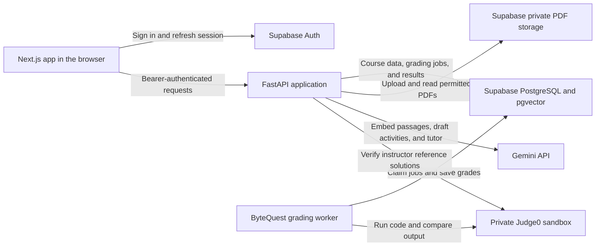

# ByteQuest 2.0

ByteQuest is a gamified programming-learning platform for undergraduate computer science students. Students practice **Python, C++, and Java**, instructors publish and grade coursework, and administrators manage course access and monitor the services. ByteQuest is a thesis system for North Eastern Mindanao State University (NEMSU).

**System status.** The [system status log](docs/BYTEQUEST_SYSTEM_STATUS_2026-11-21.md) records the latest release candidate, workstation setup and acceptance evidence.

**Release status.** Core learning workflows have local verification. Hosted classroom acceptance is pending, including capacity, security, and recovery on the intended deployment. [Release gates](docs/SYSTEM_STATUS_AND_RELEASE_PLAN.md#5-six-gates-before-a-live-classroom-pilot)

## What each role can do

| Role | Workflows |
| --- | --- |
| Student | Open the Quest Map, join Workshops, answer quizzes, and solve coding challenges. Read and run visible samples before submitting for grading. Take timed exams, read released results, track XP and badges, and open topic practice from the profile and Debugger’s Codex. |
| Instructor | Upload and version lesson PDFs, generate drafts in Authoring Studio, and edit, verify and publish through Review drafts and Activities. Manage exams and announcements. Inspect class trends, learner history, Gradebook, activity health, released exam summaries, and model evaluation. |
| Administrator | Manage accounts, course assignments, materials and platform settings. See aggregate Course health on System Overview and investigate API, database, grading-worker and sandbox health in Monitoring. |

The optional Gemini tutor supports course-aware chat, Temporary Chat, saved history where enabled, and hints after failed coding samples. Saved chat turns can recover replies after a disconnected send. ByteQuest pauses tutor access during active exams. [Tutor evaluation](docs/verification/gemini-tutor-evaluation-2026-11-20.md)

Phones and tablets use the side rail where the handheld layout applies. Hold and drag to move it, or open **Account → Accessibility → Menu position**. The instructor rail adds **More** for the full navigation. [Handheld requirements](docs/prompts/chatgpt-handheld-layout.md)

## Architecture



- **Sign-in and authorization.** Supabase Auth issues the session. FastAPI validates it and checks the active profile, role, and course membership before accessing protected data. Student self-registration checks the format and uniqueness of the school-issued ID.
- **Grading and exams.** The API records durable jobs. An independent worker claims jobs, calls Judge0, and saves grades. Sample runs use visible cases. Official submissions use the full grading set, with hidden inputs and expected outputs withheld from students. Exam content is frozen for the attempt and results follow the instructor’s release workflow.
- **Materials and AI.** Uploaded PDFs are stored privately. Searchable passages are indexed in pgvector with Gemini Embedding 2. Gemini 3.5 Flash-Lite uses relevant authorized excerpts for tutoring and activity generation. The Studio creates drafts and assigned instructors publish them through the course workspace. The shared Materials screen calls separate instructor and admin APIs.
- **Insights.** Shared charts and definitions support role-specific views. Activity health and Gradebook share grouped practice data. Student Progress links class history to learner detail. Course health summarizes enrollment, activity and current consent with small-cohort suppression.
- **Research and ML.** Deterministic rules drive live recommendations. The offline pipeline compares Logistic Regression and Random Forest on student-disjoint splits. Forecasting requires approved data, a reviewed model run, and appropriate consent. [ML evaluation and activation](ml_pipeline/README.md)

[Architecture blueprint](docs/BYTEQUEST_ARCHITECTURE_BLUEPRINT.md) · [API security and privacy](docs/LOCAL_API_SECURITY.md)

## Stack and deployment

| Layer | Technology |
| --- | --- |
| Web app | Next.js App Router, React, TypeScript, CSS design tokens, Monaco Editor, Recharts |
| API and grading worker | Python 3.11, FastAPI, SQLAlchemy |
| Application data | Supabase PostgreSQL, Auth, Storage, and pgvector |
| Code execution | Judge0 Extra CE with Python, C++, and Java runtimes. Judge0 uses its own PostgreSQL and Redis services. |
| AI and ML | Google Gemini 3.5 Flash-Lite, Gemini Embedding 2, scikit-learn |
| Infrastructure | PowerShell and Windows launchers for development, Docker Compose and Caddy for the planned VPS |

| Environment | Services |
| --- | --- |
| Local development and demo | Next.js, FastAPI, and the grading worker run on the workstation. Supabase CLI runs the data services in Docker. A private Ubuntu VM runs Judge0. The prepared core learning flow can run offline. Gemini features require internet. |
| Planned hosted pilot | Vercel serves the frontend. Caddy terminates HTTPS on the Hostinger KVM 2 VPS, which runs FastAPI, the grading worker, and private Judge0 with Docker Compose. Hosted Supabase holds the application data. Gemini is optional for the pilot. |

The VPS rehearsal needs a matching frontend and API release, applied migrations, working sign-in and recovery, private PDF access, a class-size grading test, and a tested restore. [KVM 2 deployment checklist](docs/KVM2_LIVE_PILOT_CHECKLIST.md) · [Backup and restore](docs/PHASE7_BACKUP_RESTORE_RUNBOOK.md)

## Repository layout

The paths below are on the current development branch.

```text
ByteQuest_2.0/
├── frontend/
│   ├── src/app/                 Next.js routes and shared layouts
│   ├── src/components/          Coding Arena, chat, and role workspaces
│   │   ├── insights/            Shared charts, measures, and data states
│   │   └── workspace/           Workspace controls and dockable navigation
│   ├── src/lib/                 API client, Auth, and shared types
│   ├── public/                  Static assets
│   └── scripts/                 Editor preparation and browser QA
├── backend/
│   ├── app/main.py              FastAPI application and health endpoints
│   ├── app/api/                 Student, instructor, admin, exam, and chat routes
│   ├── app/core/                Settings, authorization, database, and quotas
│   ├── app/models/              SQLAlchemy data models
│   ├── app/services/            Grading, Judge0, AI, materials, and gamification
│   ├── scripts/                 Local fixtures and verification tools
│   └── tests/                   Unit, integration, and synthetic pilot tests
├── supabase/
│   ├── config.toml              Local Supabase configuration
│   ├── migrations/              Database schema and access changes
│   └── seed.sql                 Local baseline fixtures
├── infra/                       Launchers, Judge0 setup, VPS Compose, and preflight
├── ml_pipeline/                 Feature engineering and offline model evaluation
├── docs/                        Architecture, runbooks, reviews, and evidence
│   ├── prompts/                 Handheld and role Insights implementation briefs
│   └── verification/            Dated acceptance and provider evidence
├── graphify-out/                Generated codebase knowledge graph
├── .github/workflows/           GitHub Actions regression checks
└── *-BYTEQUEST*.bat              Windows launch and offline verification shortcuts
```

[Frontend](frontend) · [Backend](backend) · [Migrations](supabase/migrations) · [Infrastructure](infra)

## Start locally on Windows

You’ll need Docker Desktop, Supabase CLI v2, Python 3.11, Node.js 20.9 or later with npm, PowerShell 7, and a configured private Ubuntu Judge0 VM.

For a new checkout, clone the repository.

```powershell
git clone https://github.com/K1ezy/ByteQuest_2.0.git
Set-Location ByteQuest_2.0
```

1. Run `PREPARE-BYTEQUEST-OFFLINE.bat` once while connected. This prepares the local containers, dependencies, frontend build, and Judge0 connection. [Preparation launcher](PREPARE-BYTEQUEST-OFFLINE.bat)
2. Run `START-BYTEQUEST.bat` to start the local stack and open sign-in. The launcher starts the API and grading worker together. [Startup launcher](START-BYTEQUEST.bat)
3. Open [local sign-in](http://127.0.0.1:3000/onboarding). Sign in to an existing test account or follow the local guide for account and course setup.

For hot reload, run `pwsh -NoProfile -File .\infra\start-bytequest.ps1 -Development` after setup. The manual setup and offline acceptance procedure are in the local guide. [Local setup and troubleshooting](docs/LOCAL_E2E.md)

To open the PC's local build from an authorized phone, use the private ZeroTier relay. [Phone setup](docs/LOCAL_E2E.md#open-bytequest-on-a-phone-over-zerotier)

## Test and verify

With local Supabase and the development dependencies available, run the following from the repository root.

```powershell
Push-Location backend
.\.venv\Scripts\python.exe -m pytest -q
Pop-Location

Push-Location frontend
npm run lint
npm run typecheck
npm test
npm run build
Pop-Location
```

The regression workflow runs the backend suite plus frontend lint, typechecking, tests, and build. Local QA includes a Judge0 language check, a synthetic multi-role rehearsal, and a handheld browser matrix. Test results and incomplete checks are recorded in the dated snapshot. [Local verification](docs/BYTEQUEST_SYSTEM_STATUS_2026-11-21.md#verification-and-remaining-checks) · [GitHub Actions workflow](.github/workflows/regression.yml)

## Configuration and security

- Local machine settings live in ignored `.env.local` files. Keep Gemini keys, Supabase privileged credentials, database passwords, and Judge0 tokens on the server.
- Use the dedicated production templates for the hosted pilot. Configure exact HTTPS origins for the API and keep Judge0, Redis, and the sandbox database on private networks.
- Enable saved chat history on the hosted pilot after checking its privacy notice, retention, deletion, and scheduled purge. Use approved synthetic accounts for deployment and recovery rehearsals. [Pilot operator runbook](docs/PILOT_OPERATOR_RUNBOOK.md)

## Documentation

- [System status log](docs/BYTEQUEST_SYSTEM_STATUS_2026-11-21.md)
- [ML evidence, operations and methodology readiness plan](docs/ML_AND_OPERATIONS_READINESS_PLAN.md)
- [20 November weekly change log](docs/BYTEQUEST_SYSTEM_STATUS_2026-11-20.md)
- [Release readiness and classroom acceptance gates](docs/SYSTEM_STATUS_AND_RELEASE_PLAN.md)
- [KVM 2 live pilot setup](docs/KVM2_LIVE_PILOT_CHECKLIST.md)
- [System design and roadmap](docs/MASTER_PLAN.md)
- [Repository guidance for coding assistants](AGENTS.md)

[MIT license](LICENSE)
