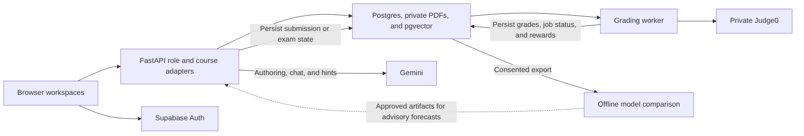

# ByteQuest 2.0 architecture review and local completion blueprint

**Reviewed 18 November 2026, Asia/Manila.** The review covers the working tree based on `3bee7ca`, including local changes to code, tests, and migrations. Use this file to decide what to build next and what evidence closes each item. It covers the student, instructor, and admin workspaces, grading, exams, AI, curriculum, data, research, and local operations.

**Start with [BQ-01](#bq-01--award-completion-xp-at-the-first-eligible-event).** A held exam pass can suppress a later coding practice award. For a quiz, the learner can earn practice XP and then receive XP for the same completion when the exam is released. Both behaviors were reproduced with synthetic records against local Postgres. Follow with [BQ-02](#bq-02--give-submission-jobs-one-owner-per-claim), where a simulated late worker failure moved a completed job back to `queued` after another worker had reclaimed it.

## 1. Where ByteQuest stands

| Area | Implemented and exercised locally | Work that remains |
| --- | --- | --- |
| Student learning | Sign-in, assigned courses, dashboard, Quest Map, Workshops, quizzes, Monaco Arena, sample runs, official submissions, progress, and rewards. Python, C++, and Java have live local sandbox evidence. | Equalize reward behavior, expand actual curriculum coverage, and verify cross-device recovery on the next local baseline. |
| Grading and exams | Private Judge0, persistent submission jobs, hidden-case redaction, grading recovery, frozen exam items, revisioned autosave, deadline enforcement, release, and retakes. | Protect recovered jobs from old workers. Expose overdue grading to staff. Decide when a timed exam needs a restricted question pool. |
| Instructor and admin | Materials, authoring, Review Queue, scheduled publication, versions, activity analysis, gradebook, announcements, account and assignment management, audit, and monitoring. | Align course scope and reporting rules across entry points. Make editor states and recovery actions consistent. |
| AI | Gemini and PDF retrieval for authoring, chat, and failed-sample hints. Draft validation and local Python, C++, and Java evaluations exist. | Close the hint reservation lifecycle, make citation claims precise, and run the same evaluated workflow students use. |
| Research and ML | Course history, shared features, offline comparisons, consent checks, and advisory forecast UI. Deterministic recommendations serve learners. | Agree on the prediction unit, cutoff, features, and label. Forecast activation depends on approved data, consent, and evaluated artifacts. |
| Local runtime | Windows launcher, local Supabase, private Judge0 VM, and a prepared offline core flow. Regression CI starts isolated local Supabase. | Verify upgrades as well as clean installs, record a repeatable local baseline, and track queue health separately from process health. |

The earlier **100% core score** means every workflow in that report's scoped local acceptance matrix received its weight. The same report's **40% hosted**, **35% live pilot**, and **26% public release** figures are historical planning estimates. Its six hosted launch gates were recorded at **0 of 6**. This review found new acceptance cases and uses observable pass criteria below. Local completion, hosted verification, and classroom study approval each have their own completion decision. [Existing score and release gates](SYSTEM_STATUS_AND_RELEASE_PLAN.md) · [Dated remediation evidence](reviews/pilot-remediation-checklist.md)

### Evidence behind this review

- **Fresh regression run.** 215 backend tests passed against local PostgreSQL with 11 framework deprecation warnings. The frontend passed 156 tests and four exam recovery invariants. Backend integration tests replace the Judge0 transport where appropriate. A separate live Judge0 run in the preceding publication fix exercised the saved-revision flow.
- **Reproduced today.** In rollback-only fixtures, a synthetic held coding pass suppressed 40 XP on the next successful practice submission. A held quiz pass still allowed 25 practice XP, and release then paid the full 65 XP already reserved for both exam items. In a simulated claim handoff, a late infrastructure error requeued a dry-run job after the replacement claim had saved its completed result. This exercises transition ordering and does not measure real multi-process timing.
- **Source-confirmed** means the current implementation contains the behavior or the competing rules. **Verify** means an operational or product hypothesis still needs an acceptance case. **Decision** means the project owner, faculty, or adviser needs to settle the policy before implementation.
- Earlier local browser, provider, restore, and load checks remain useful as dated evidence. This review used synthetic local records and source inspection. Pilot capacity, actual course material quality, and hosted recovery remain acceptance work. [Verification record](SYSTEM_STATUS_AND_RELEASE_PLAN.md#4-verification-evidence-and-its-limits) · [Regression workflow](../.github/workflows/regression.yml)

### Publication is a closed finding

The current publication module locks and refreshes the draft and matches the verification fingerprint to the saved language, reference solution, and cases. Review Queue can run verification directly. A title-only Review Queue save with identical cases retains its valid proof. Older unpublished drafts need one verification that records this proof. Keep the regression for edits, missing legacy proof, stale proof, and successful re-verification in the local release checks. [Publication module](../backend/app/services/activity_publishing.py) · [Verification proof](../backend/app/services/challenge_verification.py) · [Regression cases](../backend/tests/test_pilot_regressions.py)

## 2. How the system fits together

Keep the existing process layout. FastAPI owns business rules, Postgres stores durable decisions, Judge0 executes code, and the frontend communicates the current state. Gemini and research forecasts have independent readiness requirements. The useful refactors move repeated policy into modules with smaller interfaces. The deletion test is practical here: remove a proposed module mentally and check whether the same policy would have to be rebuilt in several callers. Preserve the existing route and worker seams for tests and keep adapters where behavior actually varies. [Main route wiring](../backend/app/main.py) · [Local workflow](LOCAL_E2E.md) · [Research pipeline](../ml_pipeline/README.md)

## 3. Work order

| Item | Priority | Recommendation | Evidence | Done when |
| --- | --- | --- | --- | --- |
| [BQ-01](#bq-01--award-completion-xp-at-the-first-eligible-event) | P0 local | Strong | Reproduced | Held grades have zero effect on visible rewards, and release grants each eligible award once. |
| [BQ-02](#bq-02--give-submission-jobs-one-owner-per-claim) | P0 local | Strong | Reproduced | Recovery gives the new claim exclusive authority to finalize a job. |
| [BQ-03](#bq-03--recover-stalled-exam-grading-and-protect-exam-content) | P1 local | Strong | Source-confirmed and decision | Staff can recover stalled exam grading. Faculty chooses and verifies the exam content policy. |
| [BQ-04](#bq-04--make-course-permissions-consistent) | P1 local | Strong | Source-confirmed and verify | Equivalent workflows agree on active, removed, and legacy membership. |
| [BQ-05](#bq-05--recover-interrupted-hint-requests) | P1 local | Strong | Source-confirmed | An interrupted provider call releases the reserved allowance, and repeat delivery costs one hint. |
| [BQ-06](#bq-06--use-one-definition-of-practice-evidence) | P1 local | Strong | Source-confirmed | Activity Analysis, Performance, Gradebook and CSV reconcile over the same eligible attempts. |
| [BQ-07](#bq-07--evaluate-the-tutor-through-the-live-workflow) | P1 local | Strong | Source-confirmed | The rater sees the exact output and provenance the learner sees. |
| [BQ-08](#bq-08--make-instructor-authoring-and-materials-one-clear-workflow) | P1 local | Strong | Source-confirmed and verify | Different authoring entry points agree on saved state, proof, scope, and errors. |
| [BQ-09](#bq-09--finish-exam-recovery-at-the-browser-seam) | P1 local | Worth exploring | Source-confirmed and verify | One browser workflow owns account, attempt, timer, and recovery coordination. |
| [BQ-10](#bq-10--stabilize-the-workspaces-and-curriculum) | P1 local | Strong | Verify | Real student and staff journeys pass the accessibility, device, and curriculum matrices. |
| [BQ-11](#bq-11--verify-data-upgrades-and-local-recovery) | P1 local | Strong | Verify | Clean install, supported upgrade, and isolated restore have repeatable evidence. |
| [BQ-12](#bq-12--make-local-operations-and-evidence-repeatable) | P1 local | Strong | Source-confirmed and verify | The team can identify the exact local build and diagnose grading delays from durable evidence. |
| [BQ-13](#bq-13--settle-the-research-prediction-contract) | P1 research | Strong | Decision | An approved feature schema, prediction unit, cutoff, and label match the manuscript and code. |
| [BQ-14](#bq-14--split-or-optimize-only-around-measured-friction) | P2 | Worth exploring | Verify | A measured problem triggers a bounded change at an existing interface. |

## 4. Findings and implementation blueprint

### BQ-01 — Award completion XP at the first eligible event

**Current flow** · Coding practice checks all earlier successful attempts. Quiz practice checks learner-visible attempts. Exam grading stores an exam-wide `pending_xp` total before release, then release grants that total. The release hold can therefore affect an award outside the exam even while the score is hidden. [Coding submission](../backend/app/api/submissions.py) · [Quiz submission](../backend/app/api/quests_gamification.py) · [Exam grading](../backend/app/services/exam_worker.py) · [Exam release](../backend/app/api/exams.py) · [Attempt visibility](../backend/app/services/attempt_visibility.py)

**Proposed flow** · Keep the policy of a single first-completion award per learner and activity. A successful practice attempt qualifies when graded. A successful exam item qualifies when its result is released. Reconcile the award inside the transaction that makes the event eligible. Reuse the learner/profile lock and evaluate badge eligibility after the visibility change. Keep attempts append-only and record which eligible activity earned the award, so the release total is traceable. Audit legacy attempts and pending totals on disposable copies before choosing how unreleased rows migrate. Preserve already-released totals as historical records unless the owner approves a separate correction. [Append-only attempt schema](../supabase/migrations/20261022000000_core_schema.sql)

**Depth and verification** · The reward module owns the ordering rules across coding, quiz, exam release, and retakes. Callers stop constructing independent prior-success queries. Add integration cases for held pass then practice pass, practice pass then exam release, failed practice with a held pass, multiple held attempts, retakes, concurrent or retried release, and account progress after each transition. Assert activity XP, badge XP, leaderboard totals, and result visibility separately. A held result must leave the same learner-visible state as an otherwise identical scenario without the held result.

### BQ-02 — Give submission jobs one owner per claim

**Current flow** · Acceptance and retry use idempotency and row locks. `claim()` marks a row running and returns its ID. Recovery changes its state when the timestamp gets stale. The old worker can still write a success or failure by ID after the job is reclaimed. Official submission has guards against duplicate attempts and rewards, while sample jobs and job state remain exposed to obsolete writes. [Job routes](../backend/app/api/submission_jobs.py) · [Worker claim, recovery and finalization](../backend/app/services/submission_worker.py) · [Official grade persistence](../backend/app/api/submissions.py)

**Proposed flow** · Give each claim a durable identity and expiry. Let the submission-job module own eligibility, expiry, retry, and terminal transitions. Validate the active claim while committing every outcome. Persist the official attempt, reward change, and terminal result together, with account and activity eligibility checked according to the accepted-job policy. Keep the wait for Judge0 outside the write transaction. Preserve an already accepted job's deadline decision during an ordinary retry. Define separately what happens on membership removal or account suspension.

**Depth and verification** · The worker adapter handles execution and reports an outcome. The job module decides whether that outcome can change state. Run a deterministic two-claim test against Postgres for late success and late failure, for both sample and official jobs. Include duplicate submit, manual retry, process interruption, exhausted retries, and a late result after successful completion. Confirm queued and running counts, terminal status, one official attempt, and one eligible reward. Repeat the scenario with interrupted local Judge0 to check real messages and recovery timing.

### BQ-03 — Recover stalled exam grading and protect exam content

**Current flow** · The exam worker processes frozen items, can reclaim an expired grading timestamp, and locks the attempt before persisting results. Failure can leave an attempt in `grading` until a later lease can be reclaimed. Release waits on grading. The exam catalog also starts from published activities, while closed practice challenges can expose the reference under the practice solution policy. This matters when the exam is intended to measure unseen proficiency. [Exam worker](../backend/app/services/exam_worker.py) · [Exam catalog, snapshots and release](../backend/app/api/exams.py) · [Practice solution policy](../backend/app/api/pilot.py)

**Proposed flow** · Apply the durable claim lessons from BQ-02 after practice is stable. The exam grading module should own a bounded attempt budget, retry timing, and a staff-visible recoverable state when the sandbox is down. Preserve submitted answers and the release hold. Faculty should document which exams are timed practice and which require a restricted item pool. For restricted exams, keep questions, keys, tests, references, and AI context scoped to that assessment until the intended release policy allows them.

**Depth and verification** · The worker and staff monitoring adapters share one meaning of grading progress. Interrupt the judge during a mixed exam and restore it. Confirm the instructor can distinguish queued, retrying, and recoverable cases. Verify an unanswered item, a learner failure, and infrastructure failure have distinct outcomes. Confirm grading and release cannot duplicate grades or rewards. For a restricted exam, use authorized synthetic learners to verify the item is absent from practice, chat context, and previews outside its allowed window.

### BQ-04 — Make course permissions consistent

**Current flow** · Course Workspaces resolve an active course assignment. Instructor Studio has separate ownership rules, including author or uploader exceptions, and some verification paths apply separate write checks. Legacy unscoped content and course-bound content need an explicit rule. Existing SQL migrations restrict browser-role access to private tables. [Course access](../backend/app/services/course_access.py) · [Faculty workspace access](../backend/app/api/faculty/common.py) · [Studio ownership and verification](../backend/app/api/rag_instructor.py) · [Database grants](../supabase/migrations/20261028140005_local_api_security.sql)

**Proposed flow** · Document who can act on course-bound materials, draft content, and reports after a membership change. Use active assignment for ordinary course-bound instructor operations. Review and explicitly retain any required legacy unscoped owner access and admin actions. Put resource-specific policy behind the existing course-access seam. Recheck it when a provider-backed operation writes after a long wait. Align role-based frontend labels with what the server authorizes.

**Depth and verification** · Compare Materials and Studio, Review Queue and Activities, and regular instructor and admin routes as adapters to the same policy. Use two private courses, co-instructors, a removed author, inactive accounts, and legacy unscoped fixtures. Exercise list, detail, edit, verify, publish, signed download, announcements, and report exports. Cover removal while a verification or PDF job is in flight. Retain separate database grant checks for browser-facing Auth and Storage usage.

### BQ-05 — Recover interrupted hint requests

**What five means today** · Each student has **five total reveals per coding challenge**. Instructor-reviewed hints and AI failed-sample hints draw from the same allowance. Rereading a saved hint or retrying a completed request key returns the same hint without taking another slot. AI hints rely on the latest completed sample being a failure. General chat uses a separate provider quota. Conceptual quizzes have no five-hint reveal mechanism. Student chat and practice help are paused during the answer window of an active exam or retake, including its configured grace window, or until submission. [Hint routes](../backend/app/api/pilot.py) · [Chat route](../backend/app/api/chat.py) · [Exam pause](../backend/app/api/exams.py) · [Existing exam pause regression](../backend/tests/test_learning_flow_integration.py)

**Current flow** · The backend persists a `Generating…` row before the provider call. It deletes the row on a handled failure. If the process stops after reservation, the existing row can keep consuming a slot, and retrying the same key returns the pending state. A successful call also calculates remaining slots from the count before the provider wait, which can be stale after overlapping requests. [Reservation and completion](../backend/app/api/pilot.py) · [Hint record](../backend/app/models/entities.py)

**Proposed flow** · Keep request-key idempotency. Put reservation, completion, recovery, and remaining allowance behind the hint module. Expire abandoned reservations and only return a hint from the current reservation. Read the remaining count at durable completion and decide how pending hints appear in the UI. Define whether a withheld AI reply that becomes generic guidance should spend a slot. Record the reason for a fallback without storing provider payloads in logs.

**Depth and verification** · The Arena can display pending, delivered, exhausted, or retryable states from a single contract. Test slots one through five and rejected slot six, simultaneous requests, repeated reviewed hint, lost response, abandoned reservation, timeout, blank provider response, and starting an exam while generation is underway. Verify the displayed allowance after reload and confirm previously delivered hints remain available after failed requests.

### BQ-06 — Use one definition of practice evidence

**Current flow** · Gradebook and Activity Analysis exclude exam attempts. Performance only requests practice-only rows when an activity is selected. The learner drill-down computes completion from the last 50 attempts used for display. With enough attempts, an earlier pass disappears from the completion count. A cohort with exam-linked attempts can show different numbers depending on the route and filter. [Faculty Performance, Gradebook and Activity Analysis](../backend/app/api/faculty/performance.py) · [Shared workspace queries](../backend/app/services/workspace_queries.py)

**Proposed flow** · Give the practice evidence module ownership of course membership, included activities and versions, attempt eligibility, and date window. Derive summary counts and display history from the same rules. Aggregate across full qualifying history before applying a page limit. Keep released exam history in a separately named view and explain metric denominators and missing grades in the UI and CSV. Define whether archived versions contribute to historic progress and which score a cell shows.

**Depth and verification** · Reports retain their own presentation and calculations while the evidence seam removes duplicated inclusion logic. Seed one learner with more than 50 attempts, a pass outside the visible page, an archived revision, a never-attempted activity, and both held and released exam attempts. Compare the class summary, focused activity rows, learner history total, gradebook cells, and CSV to a fixture with known values. Repeat at realistic course sizes and measure query count and response time before adding pagination or indexes.

### BQ-07 — Evaluate the tutor through the live workflow

**Current flow** · The evaluation script imports private chat helpers and constructs a failed-sample hint from starter code and a generic error category. The live adapter uses stored, visible sample diagnostics and follows enrollment, quota, and exam checks. Chat returns the retrieved pages as `sources` even when the model uses general knowledge or the solution guard substitutes fallback text. Retrieved material and material that supports the answer represent different evidence. [Tutor evaluator](../backend/scripts/evaluate_ai_tutor.py) · [Live chat](../backend/app/api/chat.py) · [Failed-sample hint](../backend/app/api/pilot.py) · [Retrieval](../backend/app/services/ai_rag/retrieval.py)

**Proposed flow** · Run the evaluation through authenticated local workflows with synthetic learners and genuine sample outcomes. Deepen the tutoring module around bounded public context, retrieval, provider generation, withholding, and answer provenance when the same rule needs to change in multiple adapters. Keep the Gemini client and solution guard as useful seams. Ask the model for references to specific retrieved passages and let application code reject out-of-set references. Label general guidance and withholding accurately. Establish fault categories for empty retrieval, provider refusal, timeout, invalid output, and exhausted allowance. Preserve core grading on these paths.

**Depth and verification** · A fixture starts with the actual lesson, attempted code, failed visible sample, student role, and recorded hint balance. The evaluator sees the same reply, citations, and balance as the Arena. Cover Python, C++, and Java, source-supported guidance, no relevant PDF, multiple turns, an equivalent full solution, misleading text in a synthetic PDF, a harmless request with no missing line, privacy of hidden cases, and active exam gating. Record lesson and prompt versions, retrieval mode, provider/model, run ID, and rubric scores. Use human judgment for pedagogical value and oracle checks for expected behavior. [Prior local AI evidence](SYSTEM_STATUS_AND_RELEASE_PLAN.md#expanded-local-ai-evaluation) · [Solution guard](../backend/app/services/ai_rag/solution_guard.py)

### BQ-08 — Make instructor authoring and Materials one clear workflow

**Current flow** · Studio, Review Queue, and Activities each assemble editor state, serialize cases and quiz questions, and apply review or verification actions. The saved-revision publish gate is shared. Normal save and re-verification still have different preconditions and response shapes. Materials spans PDF parsing, embeddings, private object storage, processing state, and document versions. Verification or generation can finish after the instructor has moved to another revision or course. [Studio workflow](../backend/app/api/rag_instructor.py) · [Draft update](../backend/app/api/faculty/drafts.py) · [Activity update](../backend/app/api/faculty/activities.py) · [Materials module](../backend/app/services/materials.py)

**Proposed flow** · Trace upload → select source revision → generate or author → review edits → verify → preview → publish. Give editing and verification one set of content rules, useful errors, concurrency semantics, and user-visible states. Keep individual route adapters where manual authoring, review, and generation are genuinely different tasks. Move duplicated validation and normalization after comparison tests demonstrate stable shared behavior. Keep the verified-revision check as the final write-time rule. Keep material import, replacement, archive, retry, and cleanup together under a material lifecycle with a clear reference to the originating PDF revision.

**Depth and verification** · A change to a test-case field should have one definition and one set of acceptance outcomes. Exercise generated and manual quiz/challenge drafts, co-instructors, two-tab edits, metadata-only saves, edits during verification, and a PDF archived during generation. Test corrupt, oversized, encrypted, or image-only PDFs, a partial embedding failure, a replaced version, and a storage failure. Show an actionable error, keep good existing versions, and ensure retry creates the intended version without orphaning objects. Evaluate generated drafts with independent tests, unique quiz questions, plausible distractors, complete instructions, and meaningful hidden cases across supported languages.

### BQ-09 — Finish exam recovery at the browser seam

**Current flow** · The exam answer-sync hook already owns the save queue, conflicts, deadline finalization, and local backup operations. The page still coordinates session readiness, loading or starting an attempt, server clock updates, and countdown effects. Multiple participants in the lifecycle make ordering bugs costly to test. The backend owns the cutoff and checks expected revisions. [Exam page](../frontend/src/app/%28workspace%29/exams/%5Bid%5D/page.tsx) · [Answer-sync hook](../frontend/src/app/%28workspace%29/exams/%5Bid%5D/use-exam-answer-sync.ts) · [Local recovery storage](../frontend/src/lib/supabase.ts) · [Server answer and submit routes](../backend/app/api/exams.py)

**Proposed flow** · Use the existing hook as the seam. Move orchestration there only as regression cases require it, so the rendered page can ask for the current attempt, save state, timer, and available actions without coordinating transitions. Use the latest accepted server answers on submit and preserve the attempt-scoped local snapshot until it is safe to clear. Give a consistent explanation for unsynced, conflicted, submitted, and waiting-for-release states.

**Depth and verification** · Exercise the browser interaction with two tabs, dropped save acknowledgments, refresh while offline, sign-out and account change, background-tab timer delay, a near-deadline reconnect, and a retake. Check that the instructor sees the same accepted revision, that a stale acknowledgment never clears a newer local edit, and that an old attempt cannot contaminate a new one. Keep current revision and cutoff tests. [Exam recovery acceptance guide](LOCAL_E2E.md#exam-autosave--conflict-safe-recovery-verification) · [Exam page tests](../frontend/src/app/%28workspace%29/exams/%5Bid%5D/page.test.tsx)

### BQ-10 — Stabilize the workspaces and curriculum

**Current flow** · ByteQuest has three distinct role workspaces and prior keyboard and narrow-viewport coverage. Some workflow state lives in page-level forms, some in workspace or chat providers, and some in the shared request client. Fixes can diverge across the Arena, exam page, instructor editors, and admin views. Previous lesson evidence covers a synthetic sample of the language tracks. [Navigation and past walkthrough](NAVIGATION.md) · [Request client](../frontend/src/lib/api.ts) · [Workspace provider](../frontend/src/components/workspace/workspace-provider.tsx) · [Arena](../frontend/src/components/arena.tsx)

**Proposed flow** · Keep role-specific layouts. Reuse explicit state presentations for initial loading, stale data, access loss, conflict, degraded upstreams, and confirmed writes. Make the next safe action obvious when a grade, hint, save, or provider call is pending. Preserve cursor focus, input, and retry identity. Review the actual intended local syllabus and activities with faculty. For each language, build a short progression of reviewed practice, quizzes, and exams aligned to objectives. Verify starter code, examples, edge cases, error explanations, pass mark, points, badges, and next recommendations with independent examples.

**Depth and verification** · In the browser, cover student enrollment through a result, staff authoring and grading, and admin recovery at desktop, narrow viewport, and a real phone when available. Check keyboard-only use, screen-reader labels and status announcements, focus on modals and mobile menus, 200% zoom, contrast, reduced motion, and editor versus touch interactions. Confirm the backend error code and UI action match. Test closed and scheduled work, quiz retry, partial credit, first pass, and released retakes with a faculty-reviewed test sheet. Keep the core task accessible with AI and forecasting unavailable. [Instructor surface evidence](reviews/instructor-analysis-announcements-report.md) · [Sequencer](../backend/app/services/gamification/sequencer.py)

### BQ-11 — Verify data upgrades and local recovery

**Current flow** · The migrations define durable constraints and browser-role grants. The schema tests cover timestamps, username uniqueness, states and selected row policies. Fresh local Supabase startup is part of CI. The status report records an isolated local restore of one synthetic challenge and its cases. That fixture leaves Auth, private files, report consistency, and queued work outside the evidence. [Migrations](../supabase/migrations/) · [Schema tests](../backend/tests/test_schema_integrity.py) · [Recovery runbook](PHASE7_BACKUP_RESTORE_RUNBOOK.md)

**Proposed flow** · Prepare versioned synthetic fixtures for a clean database and for one supported older schema with accounts, course assignments, draft proof, private material, official attempts, rewards, a held exam, and an in-flight job. Apply pending migrations forward on disposable local copies. Verify grant drift, private Storage paths, and the current schema. Document retention responsibilities for material versions, logs, source code, attempts, and research exports. Treat backup cleanup, account records, and research consent as distinct operations.

**Depth and verification** · Use the app and browser-facing Supabase adapters with synthetic roles. Verify sign-in, active assignments, private file issuance and expiry, expected policy behavior after removal, report reconciliation, held/released exam state, and recoverable worker state. Restore database, Auth, and private PDF fixtures to a separate local instance and measure recovery time. Confirm the source remains intact and record which objects or services require a separate restore step. Use row counts and selected checksums without exporting credentials or learner content into evidence.

### BQ-12 — Make local operations and evidence repeatable

**Current flow** · CI runs backend integration tests, frontend lint, type checking, tests, and a build. The launcher coordinates Docker Supabase, migrations, the Judge0 VM, worker, and frontend assets. Real Judge0, browser walkthroughs, recovery, and load evidence are in separate scripts and logs. A worker heartbeat can be healthy while accepted jobs wait too long. [CI](../.github/workflows/regression.yml) · [Local startup](../infra/start-bytequest.ps1) · [Worker health](../backend/app/services/monitoring.py) · [Local journey](LOCAL_E2E.md)

**Proposed flow** · Keep a named local release baseline with revision, lockfiles, migration head, runtime versions, judge image or VM version, effective test settings, and all acceptance results. Use one local checklist to invoke the existing checks. Keep meaningful operator signals for oldest queued item, oldest active claim, retries, failed jobs, held and stalled exams, and queue wait versus execution time. Tie failures to a trace or job ID and use synthetic workloads to establish performance thresholds before tuning.

**Depth and verification** · Launch from a prepared machine and from a clean isolated baseline. Verify first startup, repeat startup, missing optional AI, battery and offline mode when required, and dependency readiness. Run the browser flows and Judge0 smoke matrix against the exact baseline. Restart the worker and sandbox independently under mixed sample, official, and exam traffic. Record p50/p95 wait, execution, total latency, peak backlog, retries, and grade/XP reconciliation. Confirm staff can recognize the failed dependency and recover using the documented steps. Preserve useful evidence in versioned fixtures and scripts. Keep logs with sensitive or workstation-specific data outside the tracked record. [Real Judge0 check](../backend/scripts/verify_all_languages.py) · [Multi-role QA](../backend/tests/qa_live_multi_role.py) · [Offline test](../infra/test-offline-battery.ps1)

### BQ-13 — Settle the research prediction contract

**Current flow** · Historical views work without a model. The trainer uses student-disjoint partitions, training-only grouped cross-validation, baselines, and validation Average Precision for selection. The current feature list has 13 entries and the working manuscript alignment note records 10 intended fields. A pre-task forecast and a per-attempt forecast answer different questions. The official coding worker calls the submission path without an HTTP `Request`, which prevents its request-based shadow-scoring check from enabling the optional event. [Feature alignment](ml-feature-alignment.md) · [Shared features](../backend/app/services/ml_predictor/feature_engineering.py) · [Trainer](../ml_pipeline/train_compare.py) · [Coding worker](../backend/app/services/submission_worker.py) · [Forecast gate](../backend/app/api/submissions.py)

**Proposed flow** · Have the adviser approve one research unit, time cutoff, label, features, and allowed inputs before collecting evaluated data. If choosing first official submission per learner and task, compute inputs from strictly earlier evidence and keep retries out of the label set. If choosing attempt-level prediction, document that different research question. Deepen the forecast module around the same point-in-time rules for training and inference. Explicitly cover quiz completion, queued coding completion, and exam release if they are intended triggers. Keep the forecast advisory and separate from grades, XP, and live sequencing. Break reported metrics out by model and schema version.

**Depth and verification** · Use synthetic point-in-time fixtures to assert grouped splits, event and cutoff parity, no future-data leakage, released-exam handling, no-consent and withdrawal behavior, and unavailable or stale model state. Apply evaluation eligibility, consent, approved artifacts and documented retention before any student forecast. Keep student-level rows and linked identities out of the shared review record. Update the manuscript claim and diagrams from the verified contract. [Prediction activation](../backend/app/services/ml_predictor/predictor.py) · [Faculty ML](../backend/app/api/faculty_ml.py) · [Manuscript alignment](BYTEQUEST_MANUSCRIPT_ALIGNMENT_CHECKLIST.md)

### BQ-14 — Split or optimize only around measured friction

- **Backend request modules.** Studio has document ingestion, lifecycle, grading verification, generation, and review in a single route file. Move one workflow behind its existing interface when BQ-04 or BQ-08 needs a rule to be shared. Removing a helper should force callers to recreate policy before it earns a new seam. [Studio routes](../backend/app/api/rag_instructor.py) · [Materials module](../backend/app/services/materials.py)
- **Frontend request types.** `workspace.ts` carries multiple workspaces and their request shapes. Start with authoring and reporting contracts while those change. Split typed clients by cohesive workflow when it shortens callers or makes a route migration safer. Keep token handling, structured errors, and retry metadata centralized. [Workspace clients](../frontend/src/lib/workspace.ts) · [Request client](../frontend/src/lib/api.ts)
- **Data and UI performance.** Profile learner dashboards, course reports, exam result lists, and retrieval with term-sized synthetic data. Measure query counts and transferred bytes alongside rendering and interaction time. Batch queries, page lists, or add indexes in response to traces. [Workspace queries](../backend/app/services/workspace_queries.py) · [Retrieval](../backend/app/services/ai_rag/retrieval.py)
- **Runtime and provider capacity.** Use the mixed-load and failure evidence before changing worker concurrency, database pooling, provider models, or queue technology. Keep the existing judge and provider adapters until there is a second concrete implementation or an observed operational reason to replace one. [Worker scheduler](../backend/app/services/submission_worker.py) · [Runtime settings](../backend/app/core/config.py) · [Gemini client](../backend/app/services/ai_rag/gemini_client.py)

## 5. Local completion checklist

Use one release candidate for these checks. Each result should name the fixture, revision, expected behavior, observed outcome, and link to durable evidence.

- [ ] **Correctness.** BQ-01 and BQ-02 pass for practice, held and released exams, retries, repeated requests, and worker handoffs. Existing verified-revision publication regressions still pass.
- [ ] **Exam integrity.** One mixed exam passes autosave, refresh, offline recovery, retake, expiry, stalled-grading recovery, and release. Staff can explain content visibility and why the item pool matches the exam purpose.
- [ ] **Role scope.** A learner, two instructors, and an administrator complete expected workflows with separate courses. Assignment removal, wrong-role actions, signed-download expiry, and old account data have recorded outcomes.
- [ ] **Reporting.** Practice, exam and research metrics have written definitions. Staff reports and exported grades reconcile against known synthetic data. Long history and archived revisions behave according to those definitions.
- [ ] **AI.** Faculty reviews representative local lessons in all enabled languages. Automated and manual checks cover correct drafts, grounded help, withheld solutions, five-slot accounting, error states, and recovery. Provider failure still permits ordinary practice and grading.
- [ ] **Student and staff experience.** Keyboard, zoom, screen-reader, lab workstation, and phone checks use complete tasks. The team records the devices and paths exercised. The Quest Map, Arena, exam runner, authoring, reporting, and monitoring have clear recovery actions.
- [ ] **Curriculum.** The enabled learning sequence, grading expectations, pass marks, reward rules, and assessment scope match faculty's reviewed materials. Record the approved content revision.
- [ ] **Operations.** Clean install, schema upgrade, isolated data restore, cold and warm startup, and real Judge0 run on the named local baseline. A class-sized synthetic load gives separate queue and grading measurements. Regression, lint, typecheck, and build complete on the same revision.
- [ ] **Research scope.** The guide and manuscript identify which evidence demonstrates implementation and which needs an approved study. Forecasting remains conditional on the research decision and artifacts. [ML pipeline guide](../ml_pipeline/README.md)

### Implementation sequence

1. **Correctness first.** Add acceptance cases for BQ-01, then implement the reward policy and run the full practice and exam regression suites. Take BQ-02 next, including the late-worker tests. Keep each change independently reviewable.
2. **Close state and scope gaps.** Apply the job findings to exam recovery in BQ-03. Resolve instructor course permissions and reconcile evidence in BQ-04 and BQ-06. Test each through its real role entry points.
3. **Finish teaching workflows.** Resolve hint reservations, tutor evaluation, authoring and Materials, then browser recovery and curriculum. Include fault and absence states in every workflow. Update the local walkthrough where action labels or behavior change.
4. **Capture the local baseline.** Rehearse clean startup, upgrade and isolated restore, run the browser and real Judge0 matrix, and mark checklist items using evidence tied to one revision. Run the research discussion in parallel with product work.

## 6. Which existing document answers which question

| Question | Document |
| --- | --- |
| What should I fix next and how do I know it is done? | This blueprint. |
| Where did the percentages come from and what did the earlier local rehearsal cover? | [System status and release plan](SYSTEM_STATUS_AND_RELEASE_PLAN.md) |
| What did the original review observe and which items got follow-up? | [17 November review](reviews/system-readiness-review-2026-11-17.md) and [remediation record](reviews/pilot-remediation-checklist.md) |
| How do I run or verify the system on this workstation? | [Local end-to-end guide](LOCAL_E2E.md) and the [README](../README.md) |
| How do I interpret the architecture and original milestones? | [Master plan](MASTER_PLAN.md) |
| What do the manuscript and ML code claim? | [Manuscript alignment](BYTEQUEST_MANUSCRIPT_ALIGNMENT_CHECKLIST.md) and [feature alignment](ml-feature-alignment.md) |
| What will a later hosted rehearsal require? | [Deployment readiness](PHASE7_DEPLOYMENT_READINESS.md), [operator runbook](PILOT_OPERATOR_RUNBOOK.md), and [backup and restore runbook](PHASE7_BACKUP_RESTORE_RUNBOOK.md) |

Treat dated reviews and logs as evidence for their stated revision. When a new item closes, record its acceptance result here and link the relevant test or evidence. Use the system status report for milestone summaries and the runbooks for procedures. The owner deferred hosted purchases, provisioning, and classroom pilot testing while local hardening continues. Hosted region selection, real-class concurrency, provider configuration, institutional authorization, and isolated hosted restore have their own decision and acceptance records. [Hosted gates](SYSTEM_STATUS_AND_RELEASE_PLAN.md#5-six-gates-before-a-live-classroom-pilot)
